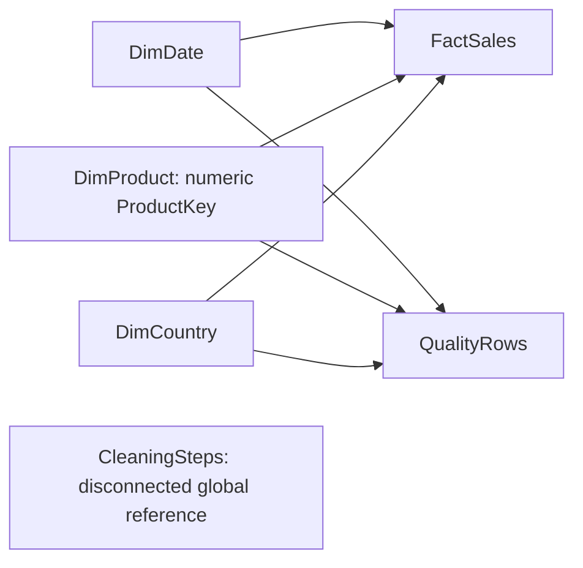

# Build the Retail Sales Analysis report in Power BI Desktop

**Status: prepared import files, model specification, M queries and DAX only. No PBIX or interactive report has been created.** This environment has no callable Power BI authoring/validation engine. The supplied M and DAX must be run and checked in Desktop before calling the dashboard complete. No other file has been renamed to `.pbix`. No database is required.

## 1. Generate or locate the import package

From the project folder:

```powershell
.\.venv\Scripts\python.exe src/prepare_powerbi.py
```

It prints a new `dashboard/powerbi_<timestamp>/` folder and validates it against the existing Python analysis. Existing files are preserved. For another validated analysis run:

```powershell
.\.venv\Scripts\python.exe src/prepare_powerbi.py --analysis reports/analysis_TIMESTAMP
```

Keep one package together. Its `manifest.json` records source hashes, exact columns, row counts and checks. `expected_filter_totals.csv` and `expected_filtered_top10.csv` are computed from the actual eligible lines, not fabricated examples. They are reference checks, not dashboard fact tables.

### Import tables and their grain

| Query/table | Source file | One row represents |
| --- | --- | --- |
| FactSales | data/FactSales.csv | One eligible completed product line, identified by SourceRow |
| QualityRows | data/QualityRows.csv | One original source line, including excluded and retained records |
| DimDate | data/DimDate.csv | One day across full calendar years 2010–2011 |
| DimProduct | data/DimProduct.csv | One exact case-sensitive source StockCode with a numeric technical ProductKey |
| DimCountry | data/DimCountry.csv | One observed source country |
| CleaningSteps | data/CleaningSteps.csv | One sequential global cleaning rule; disconnected reference only |

FactSales actual columns: SourceRow, InvoiceNo, StockCode, Quantity, InvoiceDate, SaleDate, UnitPrice, CustomerID, Country, LineSalesPence, LineSalesGBP, CustomerMetricsEligible, ProductKey.

QualityRows includes SourceRow, InvoiceDate, Country, StockCode, CustomerID, LineSalesPence, SaleDate, IsIncluded, ExclusionRule, ProductKey and all original `Flag_*` fields as integer 0/1. The full column list is in the manifest and its M query. Do not append audit.csv to completed_sales.csv: retained flagged audit rows overlap sales. The preparation script reconstructs all 541,909 original rows exactly once using completed sales plus **excluded audit rows only**.

**Case-sensitive stock codes:** actual data includes case pairs such as `85123A`/`85123a`, not only `M`/`m`. Power BI's text engine can treat these as equal. ProductKey is a technical integer assigned in source-code sort order; no codes are combined. ProductLabel includes the key for case-colliding codes so the visual axis remains distinct. StockCodeUTF8Hex records the exact source bytes; the original source strings remain in CSV. Power BI may normalize the displayed case of StockCode itself. Use **ProductLabel as the visual axis and ProductKey for relationships**, not StockCode alone. See `case_sensitive_product_codes.csv`. Do not uppercase/trim/recode products during import. ProductKey may change when regenerating a package with a different product universe: replace all related files together.

## 2. Import with exact Power Query M

1. Open Power BI Desktop > **Blank report**. Under **File > Options and settings > Options > Current File > Data Load**, disable automatic relationship detection if available, and disable **Auto date/time**. The explicit DimDate will control dates.
2. Choose **Home > Transform data**. In Power Query, **Home > New Source > Blank Query**, then **Advanced Editor**. Paste the entire file `power_query/pDataFolder.pq`; rename the query **pDataFolder**. This scalar text query points at the generated package's absolute `data/` folder. If you move the project, edit this one path. It is a local path, not a password.
3. Create another Blank Query, paste `power_query/fnLoadCsv.pq`, name it **fnLoadCsv**. This is a function: UTF-8 CSV, correct quote handling, headers, explicit en-GB types, and blank customer IDs converted to null. There is no automatic numeric conversion of identifiers. Keep scalar/function queries unloaded.
4. Create six Blank Queries named **FactSales**, **QualityRows**, **DimDate**, **DimProduct**, **DimCountry**, **CleaningSteps**. For each, paste the matching `.pq` file. Enable load for these six tables. Do not use the Text/CSV wizard's automatic Changed Type step in addition to this M.
5. Check previews: InvoiceNo, StockCode and CustomerID are Text; ProductKey and SourceRow are Whole Number; CustomerID has nulls, not 0 or an artificial ID. SaleDate and DimDate[Date] are Date, InvoiceDate is Date/Time. Quantity/LineSalesPence and 0/1 flags are Whole Number. LineSalesGBP and rule GBP amounts are Fixed Decimal Number (Currency.Type). UnitPrice is Decimal Number and is informational; never recalculate revenue from a visual average price.
6. **Close & Apply**. A privacy prompt may ask about the local source: choose the appropriate local classification for your machine. No database credentials are needed. Inspect any import errors; do not silently replace them with zero.

The preparation script exports narrow facts to keep the model practical: no repeated long descriptions in FactSales, no original-value audit text in the report fact, and no prelimited product aggregates. Full audit evidence remains in the project.

## 3. Create the model and date settings

In **Model view**, delete any automatically inferred relationships and create these **six active relationships**, all **one-to-many**, with **Single** cross-filter direction from dimension to fact:

| One side | Many side |
| --- | --- |
| DimDate[Date] | FactSales[SaleDate] |
| DimDate[Date] | QualityRows[SaleDate] |
| DimProduct[ProductKey] | FactSales[ProductKey] |
| DimProduct[ProductKey] | QualityRows[ProductKey] |
| DimCountry[Country] | FactSales[Country] |
| DimCountry[Country] | QualityRows[Country] |

Do not relate the fact tables to each other. Do not relate invoice IDs or customer IDs across them. Keep CleaningSteps disconnected. No customer dimension is needed for these pages; known-customer measures filter FactSales directly and omit missing IDs.



Select DimDate > **Table tools > Mark as date table > Date**. This guide uses a conventional marked date table and classic DAX, not the newer calendar-based time-intelligence setup. The exported date column is unique, contiguous and has no missing dates. It spans complete calendar years, while InObservationWindow identifies the measured 2010-12-01 to 2011-12-09 window.

Select DimDate[YearMonth] > **Column tools > Sort by column > YearMonthSort**. Do the same for **MonthLabel**. Format Date as `dd MMM yyyy`, MonthStart as `MMM yyyy`. Set identifiers, key columns, flags and labels to **Don't summarize** where appropriate. Hide fact Country/StockCode/SaleDate columns from report view after creating relationships, so report builders use dimension fields. Hide numeric ProductKey and StockCodeUTF8Hex from ordinary report view but retain them in the model. Set DimCountry[Country] data category to Country/Region if using a map; a bar chart avoids geocoding ambiguity and external map requirements.

## 4. Create measures

Open `dashboard/measures.dax`. Select FactSales > **Modeling > New measure**. Paste **one complete Name = expression block at a time**, in file order. These are measure definitions, not calculated columns or a single runnable DAX query. Measures can all have FactSales as their home table, including those that reference QualityRows.

Format Revenue GBP, Average Order Value GBP, Observed MoM Change GBP and Excluded Signed Value GBP as **GBP £ with 2 decimal places**, preferably `£#,##0.00;[Red](£#,##0.00)`. Use two-decimal percentage format `0.00%` for rate/percent measures. All counts and rank are whole numbers with thousands separators. Revenue Pence is an integer helper; hide it. Disable automatic K/M display units on reconciliation cards so exact totals are visible.

Revenue sums the authoritative line-rounded integer pence, dividing by 100; it never multiplies rounded unit prices again. AOV is the ratio of revenue to distinct eligible InvoiceNo, not mean line value. Missing-customer lines remain in sales measures; Known Customers and Repeat Customers exclude missing IDs. Repeat purchasing means two distinct completed orders **within the active date/country/product filter context**, not two lines or lifetime retention.

### Date and ranking behavior

- Use DimDate[MonthLabel] as the monthly axis, sorted by YearMonthSort. It visibly labels December 2010 as boundary and December 2011 as partial. Add Month Coverage to tooltips. The raw start is day 1, so December 2010 is not visibly missing calendar days, but source completeness is unverified; December 2011 ends on day 9.
- Comparable MoM Percent blanks a comparison if either month is a coverage boundary, or the current selected date range cuts a calendar month. It preserves country/product context. Previous revenue is the entire preceding calendar month even if outside the current date slicer. This convention must be stated in the tooltip. Interior months are calendar-covered, not independently proven complete.
- Observed MoM measures are optional diagnostics, not qualified growth measures. They also blank for a cut current month. The Python monthly table can show an observed boundary delta for transparency; Power BI intentionally suppresses it when the date slicer shows only part of that month. Compare qualified MoM, not these suppressed diagnostics, for the partial December case.
- Top-ten measures use ALLSELECTED(DimProduct), preserving date/country/external product selections while removing the current product row. Use ProductLabel, not FactSales[StockCode] or Description as the axis. Show Top 10 Revenue/Quantity uses TOPN with ProductKey as the deterministic secondary sort, giving up to exactly ten products; dense rank alone can include more than ten on ties.

## 5. Build the three pages

The latest package's `REPORT_LAYOUT.md` gives exact visual positions, field
wells, filters and interaction choices for these pages; use it together with
this guide. Import its `retail_theme.json` with Import theme (Design ribbon in
recent releases; View > Themes in other versions). The theme has not yet been
imported in Desktop here. Use the package's frozen measures.dax for reproducibility.
Format **Comparable MoM Change GBP** as GBP with two decimals and use it beside
Comparable MoM Percent in the monthly table. Both suppress boundary/cut months.

For product interactions, use this explicit behavior: country slicers and country
visuals filter both product charts; product-bar selections do not filter the
other product chart or country visuals. Configure with Edit interactions > None
for those product-origin interactions. This keeps the revenue and quantity
rankings independent. Verify both charts after each country/date selection.

Use a 16:9 canvas, white/light background, dark navy headers and one consistent revenue accent. Use readable labels and no 3D charts. All revenue titles must include **GBP**. Do not use categories, costs or profit because they do not exist in these data.

### Shared slicers

On each page add **Slicer > DimDate[Date]**, style **Between**, using the Date field itself rather than its automatic hierarchy. Set a visual-level filter **DimDate[InObservationWindow] = 1** on the date slicer, and select the full 01 Dec 2010–09 Dec 2011 range initially. Add a dropdown slicer **DimCountry[Country]**, with search and Select all available.

Use **View > Sync slicers** to sync both slicers across all three pages; show them on all pages. In **Format > Edit interactions**, ensure slicers **filter** every dynamic card/chart/table, rather than only highlighting charts. Default product/country bar selections may cross-highlight: choose Filter when testing exact reconciliations. Display a **Clear filters** button linked to a bookmark saved with slicers reset if desired. Avoid a hidden product selection persisting across pages.

### Page 1 — Sales Overview

1. Four cards: Revenue GBP; Completed Orders; Units Sold; Average Order Value GBP. Titles: **Completed-sales revenue (GBP)**, **Completed orders**, **Units sold**, **Average order value (GBP)**. Add Known Customers as an optional fifth card.
2. Line chart: X = DimDate[MonthLabel]; Y = Revenue GBP; categorical chronological axis; tooltips Completed Orders, Average Order Value GBP, Month Coverage, Comparable MoM Percent. Title **Monthly completed-sales revenue (GBP)**. Turn on marker tooltips; do not mix order counts on the revenue scale.
3. A small monthly table: MonthLabel, Revenue GBP, Completed Orders, Comparable MoM Percent, Month Coverage. MonthLabel sorted chronologically. Do not show totals for month-over-month measures.
4. Persistent note: **Completed sales exclude cancellations and negative adjustments; revenue is not net revenue. Dec 2010: boundary, completeness unverified. Dec 2011: partial through 9 Dec. Growth comparisons involving boundary/cut months are suppressed.**

### Page 2 — Products and Markets

1. Horizontal bar chart: category/Y = DimProduct[ProductLabel]; value/X = Revenue GBP; visual filter **Show Top 10 Revenue is 1**; sort descending by Revenue GBP. Tooltips: Units Sold and Product Revenue Rank. Title **Top 10 products by completed-sales revenue (GBP) — current selection**. Do not add a second built-in Top N filter.
2. A second horizontal bar chart: ProductLabel versus Units Sold; visual filter **Show Top 10 Quantity is 1**; sort Units Sold descending. Title **Top 10 products by units — current selection**. Long labels can be shortened in visual formatting, retaining full ProductLabel in tooltip. Never group on Description alone.
3. Country bar chart: DimCountry[Country] versus Revenue GBP; sort descending; title **Completed-sales revenue by country (GBP)**. Add a table with Country, Revenue GBP, Completed Orders, Units Sold and Average Order Value GBP. Keep anonymous sales included.
4. Set both slicers to filter both product charts. Clicking a country should filter product charts; test via Edit interactions. If clicking a product should not change country comparison, turn off just that interaction. Document whichever behavior you choose. Top-product rankings are measures evaluated on current lines, not imported static rankings.
5. Note: **Product labels are representative observed descriptions. Case-distinct codes remain separate to match validated Python; keys in some labels prevent Power BI from merging them. No product categories are inferred.**

### Page 3 — Data Quality

1. Cards: Raw Lines, Excluded Lines, Exclusion Rate, Raw Missing Customer Lines, Raw Missing Customer Rate and Retained Missing Customer Lines. All dynamic cards respond to the shared slicers. Titles distinguish **raw source lines** from **retained sales lines**.
2. Bar chart: QualityRows[ExclusionRule] versus Excluded Lines; filter QualityRows[IsIncluded] = 0; title **Excluded source lines by first applicable rule — current selection**. These counts are disjoint and sum to Excluded Lines. A rule not present in the selected data may disappear.
3. Table of measures: Cancellation Lines, Negative Quantity Lines, Nonpositive Price Lines, Exact Duplicate Extras, Missing Description Lines, Conversion Failure Lines. Title **Overlapping source flags — do not add counts**. Flags are properties, not necessarily the first exclusion reason. Duplicate group first occurrences can remain; only extra exact copies were excluded, after earlier rules.
4. Optional table from **CleaningSteps**: Step, ExclusionRule, BeforeRows, ExcludedRows, AfterRows, ExcludedSignedGBP. Sort Step ascending. Title **Global cleaning reference — unaffected by slicers**. It is disconnected intentionally; disable visual interactions from slicers and label it global. ExcludedSignedGBP is signed source line value, **not lost revenue**, net returns or profit.
5. Add a text panel with limitations below. Keep it visible when slicers change. Do not plot excluded source values as sales revenue.

### Required source and limitations panel

Source: Chen, D. (2015), Online Retail, UCI Machine Learning Repository, https://doi.org/10.24432/C5BW33 (CC BY 4.0). Local measured dates: 01 Dec 2010 08:26–09 Dec 2011 12:50. The local inspection, not source-site metadata, establishes missing-value counts.

- Completed-sales revenue is a positive eligible merchandise view, **not net revenue or profit**; cancellations, negative adjustments, nonpositive prices, reviewed charges/vouchers and extra exact copies were excluded.
- Exact-match deduplication is an analytical assumption; repeated invoice numbers with different lines were retained. Exclusion order matters for disjoint rule attribution.
- Missing IDs stay missing. Anonymous sales count toward overall revenue and orders but cannot support known-customer or repeat-customer metrics. Repeat behavior is limited to the selected observation window.
- December 2010 completeness is unverified; December 2011 is partial. Do not interpret partial-versus-full deltas as growth/decline. Interior calendar coverage is not an independent completeness guarantee.
- Large transactions were retained and can affect rankings. No return-to-sale matches, categories, costs or causal explanations are inferred.
- M and DAX are unexecuted until tested in Desktop. SQL subsequently executed on MariaDB 10.4.32 and all seven outputs reconciled with Python; see reports/sql_reconciliation.md. This does not validate Power BI measures or visuals.

## 6. Reconciliation checklist before saving a PBIX

Reset ALL report/page/visual filters and selections. Keep the date slicer at the entire measured range, all countries, and no product filters. Turn off display-unit abbreviations and show GBP two decimals.

| Check | Expected |
| --- | ---: |
| FactSales rows / Included Lines | 522,540 |
| Revenue GBP | £10,247,219.32 |
| Completed Orders | 19,773 |
| Units Sold | 5,561,387 |
| Average Order Value GBP, displayed to 2 dp | £518.24 |
| Known Customers | 4,334 |
| Repeat Customers | 2,829 |
| Repeat Customer Rate | 65.27% |
| Raw Lines | 541,909 |
| Excluded Lines | 19,369 |
| Raw Missing Customer Lines | 135,080 |
| Retained Missing Customer Lines | 131,387 |
| Cancellation Lines | 9,288 |
| Negative Quantity Lines | 10,624 |
| Nonpositive Price Lines | 2,517 |
| Exact Duplicate Extras (all source flags) | 5,268 |
| Conversion Failure Lines | 0 |

Then:

1. Compare all 13 months with `reports/analysis_20261017T163159_486015Z/monthly.csv` (or the new analysis path in the manifest). November 2011 revenue must be £1,452,115.98; partial December 2011 revenue £614,490.92. The **comparable** MoM measure is blank for boundary pairs. Ensure month labels do not sort alphabetically and there is no unidentified blank date bucket.
2. Compare both default top tens with the analysis product CSVs. Revenue leader: 22423, £174,156.54. Units leader: 23843, 80,995 units. Distinct case suffix codes must not be silently merged; use the numeric key and collision-safe label.
3. Compare countries to `countries.csv`; United Kingdom revenue £8,724,443.67 across 17,901 completed orders.
4. For each row in **expected_filter_totals.csv**, set the listed date bounds and country; compare all listed revenue/order/unit/customer/quality measures. Compare both product charts to that scenario in **expected_filtered_top10.csv**. This verifies ranking and both facts react to slicers, not just the initial totals.
5. Move a date bound into the middle of a month: its current-month qualified MoM must blank. Clear country/date filters afterward. Select a country with different leading products and confirm top tens recompute. Test a no-sales selection; blank cards must not be mistaken for data loss.
6. Check Raw Lines = Included Lines + Excluded Lines under each date/country scenario. Exclusion bars must sum to Excluded Lines. Overlapping flag cards will not sum to this total and should not be made to do so.
7. If totals differ: inspect relationships/directions, type conversions, implicit Count versus DistinctCount, accidental duplicate imports, text-case product grouping and lingering visual filters. Never adjust reference totals to force a match.

Only after these checks pass, **File > Save As > Retail Sales Analysis Dashboard.pbix** in a new project output location. That save is the point at which a native Desktop report exists. Report this as an interactive Power BI report; a Power BI Service dashboard is a separate published artifact and is not created by this guide.

## 7. Refresh and maintain

**Home > Refresh** rereads the current packaged CSVs; it does not run cleaning/analysis Python. After a new validated run, rerun analysis and packaging, edit **pDataFolder** in Power Query to the new package's `data/`, and refresh all six tables together. Recheck relationships and all reconciliation scenarios; ProductKey is package-specific. Keep previous packages and PBIX versions. Do not edit imported facts to patch totals.

Keep local file paths and dataset attribution in documentation; no passwords are needed or stored. Do not publish the report or upload customer-level data without deciding its intended audience; this preparation does not publish anything.

## Official implementation references

- Star schema and dimension-to-fact modeling: https://learn.microsoft.com/power-bi/guidance/star-schema
- Mark a conventional date table: https://learn.microsoft.com/en-us/power-bi/transform-model/desktop-date-tables
- UTF-8 CSV parser options: https://learn.microsoft.com/en-us/powerquery-m/csv-document
- Explicit Power Query column types: https://learn.microsoft.com/en-us/powerquery-m/table-transformcolumntypes
- Preserve external selections for visual rankings: https://learn.microsoft.com/en-us/dax/allselected-function-dax
- Top-N ordering and tie behavior: https://learn.microsoft.com/en-us/dax/topn-function-dax
